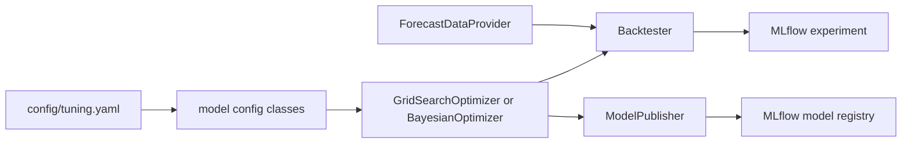
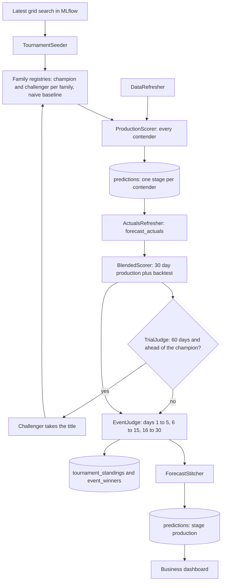
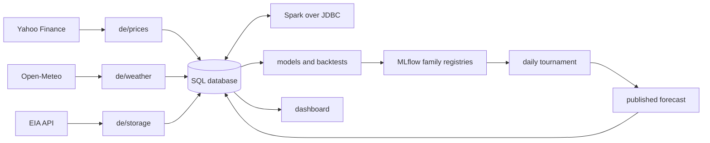

# natural-gas-forecasting

**Start here: [grid search backtest notebook](experiments/grid_search_backtest.ipynb).** It runs every model on the same 125 rolling as-of dates, forecasts 30 trading days ahead from each, scores them, and publishes the winner to the MLflow model registry. The [Bayesian search notebook](experiments/bayesian_backtest.ipynb) repeats the search with Optuna. Every day after that, the [model tournament](#the-model-tournament) turns the results into one published forecast: each model family's champion competes in three horizon events, and the event winners make up the business facing forecast.

Daily forecasts of the natural gas front-month futures price (Yahoo Finance `NG=F`, daily high), using weather in major gas-demand cities and EIA weekly storage as inputs.

## Why it matters

Natural gas is one of the most volatile commodities there is. Utilities, power plants, and industrial buyers plan purchases days and weeks ahead, and a few cents per MMBtu on millions of MMBtu is real money. Weather drives demand, storage shows how tight supply is, and the futures price reacts to both.

Most forecasting demos stop at one model on one train and test split. This project is built the way a production team would want it: every model is backtested on the same dates with no look-ahead, every run is logged, and a model only replaces the baseline when it earns it. In production that rule becomes a tournament: challengers prove themselves over 60 live days before they take a title, and each horizon of the published forecast goes to whichever champion is actually best at it.

## What it shows

Prices from 2015-01-02 to 2026-11-18. 125 as-of dates every 14 days from 2021-12-31 to 2026-10-02, each forecasting the next 30 trading days (`backtest.horizon_days` in `config/tuning.yaml`). The two as-of dates after 2026-10-02 are skipped because 30 trading days of actuals do not exist yet. Same dates for every model. Best config per model, MAE, RMSE, and bias in dollars per MMBtu, MAPE and WAPE in percent.

Grid search (61 configs):

| Model | MAE | RMSE | MAPE | WAPE | Bias | Best config |
| --- | --- | --- | --- | --- | --- | --- |
| Chronos-2 | 0.5192 | 0.7975 | 13.12 | 13.65 | -0.0420 | context 512, weather, yearly off |
| Gradient boosting | 0.5212 | 0.8028 | 13.41 | 13.70 | 0.0077 | 5 lags, depth 2, learning rate 0.03, no weather, yearly on |
| Naive | 0.5259 | 0.8107 | 13.50 | 13.82 | 0.0037 | none |
| Greykite | 0.7362 | 1.0741 | 19.36 | 19.35 | 0.0030 | 4 years, 3 price lags, holiday dummies off |

Bayesian search (25 configs, 8 trials per model):

| Model | MAE | RMSE | MAPE | WAPE | Bias | Best config |
| --- | --- | --- | --- | --- | --- | --- |
| Chronos-2 | 0.5221 | 0.7893 | 13.37 | 13.72 | -0.0273 | context 320, no weather, yearly off |
| Naive | 0.5259 | 0.8107 | 13.50 | 13.82 | 0.0037 | none |
| Gradient boosting | 0.5343 | 0.8203 | 13.72 | 14.04 | -0.0010 | 4 lags, depth 2, learning rate 0.019, min leaf 20, weather, yearly on |
| Greykite | 0.7821 | 1.1131 | 20.68 | 20.56 | -0.0172 | 6.9 years, 1 price lag, ridge, holiday dummies off |

MAE by horizon bucket, best grid config per model:

| Model | Days 1 to 5 | Days 6 to 15 | Days 16 to 30 |
| --- | --- | --- | --- |
| Chronos-2 | 0.2518 | 0.4628 | 0.6459 |
| Gradient boosting | 0.2473 | 0.4594 | 0.6537 |
| Naive | 0.2476 | 0.4656 | 0.6589 |
| Greykite | 0.3039 | 0.6123 | 0.9629 |

Yearly calendar features (2 Fourier harmonics of the day of year) are the only calendar option tuned. Weekly harmonics and the after weekend flag stay off. Best config with yearly off and on:

| Model | Search | Off: MAE / RMSE / WAPE | On: MAE / RMSE / WAPE |
| --- | --- | --- | --- |
| Chronos-2 | Grid | 0.5192 / 0.7975 / 13.65 | 0.5248 / 0.8023 / 13.80 |
| Chronos-2 | Bayesian | 0.5221 / 0.7893 / 13.72 | 0.5262 / 0.8047 / 13.83 |
| Gradient boosting | Grid | 0.5236 / 0.8024 / 13.76 | 0.5212 / 0.8028 / 13.70 |
| Gradient boosting | Bayesian | 0.5378 / 0.8245 / 14.14 | 0.5343 / 0.8203 / 14.04 |

Chronos-2 beat naive by 1.28 percent in grid search, clearing the 1 percent margin, so the publisher registered it as `natgas-price-forecaster` version 8 (`@champion`), the same config as version 7. Bayesian search found Chronos-2 at context 320 without weather, only 0.74 percent better than naive, so on its own it would keep naive.

What the numbers say:

- Over 5 days nothing beats repeating the last price. Over 30 days Chronos-2 pulls ahead, and the gap grows with the horizon: it trails naive on days 1 to 5 and leads on days 16 to 30.
- Chronos-2 does not need weather to win. Without it, context 512 scores MAE 0.5204, 1.05 percent better than naive, with a lower RMSE (0.7774) than the weather config. Weather helps a little, but backtests hand it perfect weather for all 30 days, so treat that gain as an upper bound.
- Yearly terms help gradient boosting a little and hurt Chronos-2. In the grid they lower gradient boosting MAE in 14 of 16 matched configs (0.0046 on average) and the best drops from 0.5236 to 0.5212, now 0.90 percent better than naive, still short of the margin. For Chronos-2 they are worse in all 6 matched configs.
- Holiday dummies did not help Greykite, and Silverkite's trend and seasonality terms drift badly past two weeks.

## How it works



Every model subclasses `AbstractModelWrapper` (`train`, `predict`, `save`, `load`) and takes a config class that subclasses `AbstractConfigWrapper` (defaults, validation, grid, search space, and what the backtester needs). The backtester, optimizers, and publisher work with any of them.

### Code highlights

`ForecastDataProvider` is the only way a model gets data. It hands out a `ForecastWindow` per as-of date, and `Backtester` refuses to run a window that leaks:

```python
@staticmethod
def check_no_leakage(
    as_of: pd.Timestamp, training_data: pd.DataFrame, forecast_dates: pd.DatetimeIndex
) -> None:
    """Stop the run if any training row is after the as-of date."""
    if training_data.index.max() > as_of:
        raise AssertionError(f"Training data goes past the as-of date {as_of.date()}")
    if forecast_dates.min() <= as_of:
        raise AssertionError(f"Forecast dates must start after {as_of.date()}")
```

`ChronosModel` runs Amazon Chronos-2 zero-shot. The context is prices up to the as-of date, and degree days for the forecast dates go in as known future covariates. The median is the point forecast, and the 10th and 90th percentiles make an 80 percent interval:

```python
forecast = pipeline.predict_df(
    self.context_frame(),
    future_df=self.future_covariates(future_features, future_calendar),
    prediction_length=len(future_calendar),
    quantile_levels=[LOWER_QUANTILE, MEDIAN_QUANTILE, UPPER_QUANTILE],
    id_column=ID_COLUMN,
    timestamp_column=TIME_COLUMN,
    target=TARGET_COLUMN,
    context_length=self.config.context_length,
    freq="B",
)
```

`ModelPublisher` only replaces naive when the winner clears the margin:

```python
improvement = 1 - best.metrics()[metric] / baseline.metrics()[metric]
if best.model_name == BASELINE_MODEL:
    return PublishDecision(baseline, "naive had the lowest error", 0.0)
if improvement >= self.min_improvement:
    reason = f"{best.model_name} beat naive by {improvement:.2%}"
    return PublishDecision(best, reason, improvement)
```

### Models

| Model | What it does |
| --- | --- |
| `NaiveModel` | Repeats the last price. The baseline every other model has to beat. |
| `GradientBoostingModel` | scikit-learn gradient boosted trees on recent daily price changes, plus optional degree days and calendar features. Forecasts several days ahead by feeding each prediction back in. |
| `GreykiteModel` | LinkedIn Greykite Silverkite: trend, seasonality, recent prices as lags, and US holiday dummies as regressors. Each holiday gets a dummy for the day itself and for up to 4 days before and after (`labor_day_pre_2`, `labor_day_post_1`). Dummies that are never 1 in the training window are left out. |
| `ChronosModel` | Amazon Chronos-2, a pretrained time series model, used zero-shot on CPU. Degree days and calendar features can be passed as known future covariates. Tuned on context length, weather, and the yearly terms. |

### Data, backtests, search, and publishing

| Class | Job |
| --- | --- |
| `ForecastDataProvider` | Give it an as-of date and it returns a `ForecastWindow`: training data on or before that date, feature values for the dates to predict, and the actual prices used to score the forecast. |
| `AbstractFeatureSource` | Base class for extra data. Each source returns only what was known on the as-of date. `WeatherFeatureSource` adds heating and cooling degree days. `HolidayFeatureSource` adds US holiday dummies from the `holidays` package, which are known in advance and so are valid for the forecast dates. `CalendarFeatureSource` adds Fourier terms for the time of year (2 harmonics) and day of week (1 or 2 harmonics) and an `after_weekend` flag for the first weekday after a weekend; these depend only on the date. Only the yearly terms are tuned. `StorageFeatureSource` adds the EIA storage level once each weekly report is published. |
| `Backtester` | For each as-of date gets the window, checks for leakage, trains a fresh model, predicts, and records a `BacktestResult`. Runs dates in parallel with `n_jobs`. |
| `BacktestReport`, `ForecastMetrics` | Score one config: MAE, RMSE, MAPE, WAPE, and bias, overall, by days ahead, and by horizon bucket (days 1 to 5, 6 to 15, 16 to 30). |
| `AbstractOptimizer` | Backtests candidate configs, logs each one as a nested MLflow run, skips repeats, records failures without stopping, and builds the results table with skill against naive. |
| `GridSearchOptimizer`, `BayesianOptimizer` | Every combination in the grid, or Optuna's TPE sampler picking each next config from the ones already scored. |
| `ModelPublisher` | Publishes the best config only if it lowers error by at least `min_improvement` against naive (1 percent by default). The chosen config is retrained on all data, logged as an MLflow pyfunc model, registered, and given the `champion` alias. |
| `TuningPipeline` | Runs all of the above from `tuning.yaml`. `natgas tune` calls it. |

To add a model, create a folder under `models/` with a config class and a model class, add the pair to `ModelCatalog`, and give it a grid and search space in `tuning.yaml`. Nothing else changes.

### No look-ahead

- Training data always ends on the as-of date, and the test period starts the next trading day. The backtester checks this on every window.
- Storage values only appear once EIA would have published them (6 days after the week ends).
- Weather for future dates would come from the forecast made on the as-of date. Past forecasts are not stored, so backtests use the observed weather as a perfect forecast. This makes weather models look better than they will live, and much more so at 30 days than at 5: real weather forecasts lose most of their skill after about two weeks, while the backtest still hands the models the exact weather for days 16 to 30. Pass `use_observed_as_forecast=False` to `WeatherFeatureSource` to hide future weather instead. Production scoring cannot see future weather either, so it uses the real forecast and then normals (see below).

## Quickstart

Requires Python 3.10 (Greykite does not support newer versions yet). Greykite 1.1 pins pandas below 2.0, numpy 1.26.0, and scikit-learn 1.3.1. Chronos-2's package metadata asks for pandas 2, but the forecast API used here works with pandas 1.5, so it is installed in a second step that leaves pandas alone. Install the CPU build of PyTorch first on a machine without a GPU.

```bash
python -m venv .venv
source .venv/bin/activate
pip install torch --index-url https://download.pytorch.org/whl/cpu
pip install -e ".[dev]"
pip install "chronos-forecasting>=2.0" --no-deps

export EIA_API_KEY=your_key   # optional, storage is skipped without it
natgas init-db
natgas ingest all             # 2015-01-01 through today by default
natgas tune                   # backtest, log to MLflow, register the best model
natgas tournament seed        # champion and challenger per family from the grid search
natgas score                  # score every contender, run the tournament, publish
```

More commands:

```bash
natgas ingest prices --start 2024-01-01 --end 2024-06-30
natgas tune --optimizer bayesian     # Bayesian search instead of grid
natgas tune --no-publish             # backtest and log only
mlflow ui --backend-store-uri sqlite:///mlflow.db
make lint && make test
```

Loaders upsert on each table's key, so reruns do not create duplicates. Every run is logged to the `ingestion_runs` table. Run commands from the repo root: MLflow runs go to `mlflow.db` with artifacts in `mlruns/`, both git ignored. Chronos-2 weights are downloaded from Hugging Face the first time and cached; only the model id is saved with a published model. Load any family champion anywhere with:

```python
import mlflow

mlflow.set_tracking_uri("sqlite:///mlflow.db")
model = mlflow.pyfunc.load_model("models:/natgas-chronos@champion")
model.predict(future_dates_frame)  # columns: date plus the features the model uses
```

`natgas tune` still registers its single overall winner as `natgas-price-forecaster@champion` (versions 1 to 9 live there), which the notebooks and `natgas export-backtests` read. Daily scoring only uses the per family registries.

On an 8 core CPU the grid notebook takes about 25 minutes and the Bayesian notebook about 40, most of it Greykite.

## The model tournament

No single model wins every horizon. In the backtests gradient boosting is best over days 6 to 15, Chronos-2 is best over days 16 to 30, and over days 1 to 5 nothing clearly beats repeating the last price. So instead of crowning one model, the daily job runs a tournament, organized like the Olympics.

**Trials.** Every model family (Chronos-2, gradient boosting, Greykite) has its own MLflow registered model, `natgas-chronos`, `natgas-gradient-boosting`, and `natgas-greykite`, each with a `@champion` and a `@challenger`. A challenger is a model in trials. It is scored every day next to its family champion, and it earns the title only after 60 matured production days with a lower blended MAE than the champion. When that happens the aliases swap: the challenger becomes `@champion`, and the former champion goes back to trials as `@challenger`, also tagged `@legacy_champion`. Naive is not a family. It is the baseline, `natgas-naive@baseline`, scored every day so everyone has something to beat.

**Events.** Family champions compete in three events, one per horizon: days 1 to 5, days 6 to 15, and days 16 to 30. To qualify for an event a champion must follow the domain rules and beat naive in that event by at least `min_improvement` (1 percent lower error). The qualified champion with the lowest blended MAE wins the event. If nobody qualifies, naive wins it, because a model that does not clearly beat "repeat the last price" is not worth the risk.

**The scorecard.** Trials and events use the same blended score. A model is judged on the last 30 as-of dates whose forecasts have matured in production. A new model has little production history, so its backtest fills the rest of the window:

```
prod_weight = min(prod_days, 30) / 30
blended_mae = prod_weight * prod_mae + (1 - prod_weight) * backtest_mae
```

On day one the score is the backtest MAE of that exact version in that exact bucket. After 15 matured days it is half production and half backtest. After 30 it is pure production. If a version has no backtest score for a bucket, the naive backtest MAE stands in.

**The podium.** The three event winners are stitched into one 30 day forecast, saved as stage `production` in `predictions`. That is the business facing forecast for the dashboard. Each row keeps the model and registry version of the winner that produced it, and the numbers are copies of what that winner forecast in its own stage, so what is published is exactly what was scored.

**Domain rules.** Chronos-2 must use weather covariates, and Greykite must not use weather. Seeding only picks configs that follow them, the scorer refuses to score a config that breaks them, and a rule breaker cannot qualify for an event.

Opening day, as of 2026-11-18. Every contender has zero matured production days, so every blended MAE is its backtest MAE:

| Event | Winner | Blended MAE | Naive | Better than naive | Also ran |
| --- | --- | --- | --- | --- | --- |
| Days 1 to 5 | Naive (`natgas-naive` v1) | 0.2476 | 0.2476 | 0.00% | gradient boosting 0.2473 (0.15%, short of the 1% margin), Chronos-2 0.2518, Greykite 0.3039 |
| Days 6 to 15 | Gradient boosting (`natgas-gradient-boosting` v1) | 0.4594 | 0.4656 | 1.34% | Chronos-2 0.4628 (0.61%), Greykite 0.6123 |
| Days 16 to 30 | Chronos-2 (`natgas-chronos` v1) | 0.6459 | 0.6589 | 1.98% | gradient boosting 0.6537 (0.79%), Greykite 0.9629 |

The published forecast for 2026-11-18 is naive for days 1 to 5, gradient boosting for days 6 to 15, and Chronos-2 with its 80 percent interval for days 16 to 30. All three challengers started their trials the same day.

Seeded families, from the latest 30 day grid search:

| Registry | `@champion` | `@challenger` |
| --- | --- | --- |
| `natgas-chronos` | v1: context 512, weather, yearly off, MAE 0.5192 | v2: context 2048, weather, yearly off, MAE 0.5225 |
| `natgas-gradient-boosting` | v1: 5 lags, depth 2, learning rate 0.03, no weather, yearly on, MAE 0.5212 | v2: same with yearly off, MAE 0.5236 |
| `natgas-greykite` | v1: 4 years, 3 price lags, holiday dummies off, MAE 0.7362 | v2: 4 years, 3 price lags, holiday dummies on with a 2 day window, MAE 0.7479 |
| `natgas-naive` | `@baseline` v1, MAE 0.5259 | |

Chronos-2 without weather scored 0.5204 in the grid, second best, but it breaks the weather rule, so the next best weather config is the challenger. Greykite's second best config (holiday window 2 with holidays off) forecasts exactly the same as the best one, so the seeder skips it and takes the next distinct config.



### Tournament code highlights

`BlendedScorer` moves each score from the backtest to production as the window fills:

```python
@staticmethod
def blend(
    prod_mae: float, prod_days: int, backtest_mae: float, window_days: int = 30
) -> tuple[float, float]:
    """prod_weight and blended_mae."""
    prod_weight = min(prod_days, window_days) / float(window_days)
    prod_mae = prod_mae if prod_days > 0 else 0.0
    return prod_weight, prod_weight * prod_mae + (1 - prod_weight) * backtest_mae
```

`EventJudge` only lets a champion into an event when it follows the rules and clearly beats naive:

```python
def qualifies(self, champion: Contender, score: BlendedScore, baseline: BlendedScore) -> bool:
    if champion.config is None or not ModelRules.passes(champion.config):
        return False
    return score.blended_mae <= baseline.blended_mae * (1 - self.min_improvement)
```

`ChallengerTrial` decides when a challenger has earned the title:

```python
@property
def eligible(self) -> bool:
    return self.trial_days >= self.required_days and self.challenger_ahead
```

| Class | Job |
| --- | --- |
| `TournamentConfig` | Families, baseline, trial days (60), scorecard window (30), and the qualifying margin, from the `tournament` section of `config/tuning.yaml`. |
| `Contender` | One registry alias and the version, config, and backtest MAE per bucket behind it. Its stage is the name its forecasts get, such as `chronos:champion` or `baseline:naive`. |
| `FamilyRegistry` | Loads every contender from its registry alias, reads backtest MAE from the version tags, and swaps the titles on a promotion. |
| `TournamentSeeder` | Seeds every family from the latest grid search: best valid config as `@champion`, next best distinct valid config as `@challenger`, naive as `@baseline`. Uses the scores the grid search logged, so nothing is backtested again. |
| `ModelRules` | Chronos-2 must use weather, Greykite must not. |
| `BlendedScorer`, `BlendedScore` | The 30 day production plus backtest scorecard per contender and bucket. |
| `TrialJudge`, `ChallengerTrial` | Counts each challenger's matured production days since its trial started and compares it with its champion. |
| `EventJudge`, `EventResult` | Qualifies the champions for one event and picks the winner, or naive. |
| `ForecastStitcher` | Copies each winner's forecasts for its days into stage `production`. |
| `TournamentStore` | Writes `tournament_standings`, `event_winners`, `challenger_trials`, and `promotion_history`. |
| `ModelTournament`, `TournamentOutcome` | One daily round: trials and promotions, scorecard, events, standings, and the stitched forecast. |
| `LegacyStageRelabeler` | One time cutover: renames rows from the old single registry setup to `legacy:champion` and `legacy:challenger`. |
| `TournamentSimulator` | Replays past trading days through scoring, actuals, and the tournament, one day at a time, with nothing from after each day. |
| `BacktestTrimmer`, `BacktestTagRefresher` | Drop backtests made on or after the first replayed day, and rescore each version's `backtest_` tags from forecasts whose target date came before it. |
| `ProductionHistoryReset` | Empties the prediction and tournament tables before a replay. Source data and backtests stay. |

```bash
natgas tournament seed               # once: champion and challenger per family from the latest grid search
natgas tournament seed --force       # seed again after a new grid search, restarting every trial
natgas tournament standings          # latest event winners, trials, and standings
natgas tournament simulate --end 2026-11-18 --days 60 --trim-backtests --reset
                                     # replay the last 60 trading days as production
```

### Replaying the past as production

A new tournament has no production record, so the scorecard leans on backtests for its first 30 days and no trial can finish for 60. `natgas tournament simulate` builds that record by replaying past trading days as if each one were today. For every day, oldest first, prices, weather, and storage after that day are dropped before any model sees them. There is no stored weather forecast from back then, so every future date gets the 10 year smoothed daily normal from weather observed up to that day. Every contender is scored under a run id that starts with `sim_`, matured forecasts get their actual price, and the tournament runs for that day. Live runs after the replay get plain hex run ids, so the dashboard can tell the two apart.

`--trim-backtests` keeps backtests and production apart: backtests made on or after the first replayed day are removed from `backtest_forecasts` and its Parquet copy, and each version's `backtest_` tags are rescored from forecasts whose target date came before that day, so the scorecard never borrows a price the replay has not reached yet. `--reset` empties `predictions`, `forecast_actuals`, and the tournament tables first.

`natgas tournament seed` refuses to run when a family already has a champion, so trial progress is never wiped by accident. It also widens the `stage` column of older databases (`StageColumnMigrator`) and relabels the pre-tournament rows, so `production` only ever means the tournament's published forecast.

## Production scoring

`natgas score` (or `make score`) is the daily job. Run it by hand, from cron with `scripts/run_scoring.sh`, or as a Prefect flow (see Prefect below).

1. `DataRefresher` reloads the last 30 days of prices, weather, and storage with the same loaders as `natgas ingest`, so late corrections replace earlier values.
2. The as-of date is the latest trading day before today. Today's bar is still trading, so it is never used. `ProductionScorer` loads every contender from its registry alias (`@champion` and `@challenger` of each family, and `natgas-naive@baseline`), refits each version's config on data through the as-of date, the same way every backtest ran, and saves 30 rows per contender under its own stage. The scorer refuses a Chronos-2 config without weather or a Greykite config with weather.
3. `ActualsRefresher` copies every forecast whose target date has a price into `forecast_actuals`, with the actual and the error, and `ForecastMonitor` recreates the `forecast_accuracy` and `forecast_accuracy_rolling` views: MAE, MAPE, WAPE, and bias by stage and horizon bucket (days 1 to 5, 6 to 15, 16 to 30, and all days), over all matured forecasts and over the last 20 as-of dates.
4. `ModelTournament` judges the 60 day trials and promotes any challenger that earned it, scores every contender on the blended scorecard, runs the three events, saves the standings, winners, and trial progress, and stitches the winners into stage `production`.

`PredictionStore` only appends. A stage that already has rows for the as-of date is skipped, and the table key (`as_of_date`, `stage`, `horizon_day`) blocks duplicates, so reruns are safe. The tournament tables are keyed by as-of date, so a rerun replaces that day's standings instead of adding to them.

Future weather. Chronos-2 uses degree days for the 30 forecast days, and those days have not happened yet. `ForecastWeatherFeatureSource` fills them with the Open-Meteo forecast that the weather loader stores (14 days, `weather.forecast_days` in `config/settings.yaml`, which covers about 10 trading days) and, after that, the daily normal: the average degree days for that day of the year over the last 10 years, smoothed over 15 days. The backtests used observed weather for all 30 days, so expect live accuracy on days 11 to 30 to sit closer to Chronos-2 without weather. The blended scorecard picks that up on its own as production days replace backtest days.

Forecast dates past the last price skip exchange holidays (`TradingCalendar`), so every forecast gets an actual.

```bash
natgas tournament seed       # once: champion and challenger per family
natgas export-backtests      # backtest_forecasts table and outputs/backtest_forecasts.parquet
natgas score                 # refresh, score, backfill actuals, run the tournament
natgas score --no-refresh    # score from the data already loaded
natgas tournament standings  # what the last run decided
```

Or open [`notebooks/run_daily_update.ipynb`](notebooks/run_daily_update.ipynb) and run all cells to do the same job by hand.

### Prefect

`ScoringFlow` runs the same job as a Prefect 3 flow, `natgas-daily-scoring`, with one task per stage: `refresh_data` (retries twice, 30 seconds apart, for network hiccups at Yahoo, Open-Meteo, or EIA), `score_models`, `backfill_actuals`, and `run_tournament`. The tasks call `ScoringPipeline`'s stage methods, so `natgas score` and `natgas flow` write the same rows and reruns stay safe. The open-source Prefect server shows run history, each task's state and logs, failures with tracebacks, and the schedule at http://127.0.0.1:4200.

Run from the repo root. Start the server in one terminal and leave it open:

```bash
prefect server start          # UI at http://127.0.0.1:4200, data in ~/.prefect
```

In a second terminal, point the client at it, then run once or serve the schedule:

```bash
prefect config set PREFECT_API_URL=http://127.0.0.1:4200/api   # once per machine
natgas flow --no-refresh      # one tracked run from the data already loaded
natgas flow                   # one tracked run with a data refresh
natgas serve                  # deployment natgas-daily-scoring, 07:00 Tuesday to Saturday America/New_York
prefect deployment run natgas-daily-scoring/natgas-daily-scoring   # trigger the served deployment now
```

`natgas serve` keeps running and starts each scheduled run itself, at most one at a time; stopping it with Ctrl+C pauses the schedule until the next `natgas serve`. Both the server and `natgas serve` must be running at 07:00, so on Windows start them at logon with Task Scheduler. Without `PREFECT_API_URL`, `natgas flow` starts a temporary server for that run only, and nothing is kept for the UI. The same commands work in PowerShell; use `.venv\Scripts\natgas.exe` if the virtual environment is not activated.

Prefect 3.8 breaks on FastAPI 0.151 and later, so `pyproject.toml` caps FastAPI below 0.151.

`export-backtests` takes the best config per model from the latest 30 day grid search in MLflow and writes the forecasts that search logged. Chronos-2 is backtested again on the same as-of dates only to add its interval, and as-of dates where the rerun does not match the logged forecast (for example after the weather archive revised recent days) get no interval.

Tables and views in `data/natgas.db`:

| Name | Kind | Columns |
| --- | --- | --- |
| `backtest_forecasts` | table, rewritten by the export | as_of_date, target_date, horizon_day, model, model_version, forecast, lower, upper, actual |
| `predictions` | table, append only | run_id, run_timestamp, as_of_date, target_date, horizon_day, model, model_version, stage, forecast, lower, upper |
| `forecast_actuals` | table, matured predictions | the `predictions` columns plus horizon_bucket, actual, error (forecast minus actual), filled_at |
| `forecast_accuracy` | view | model, stage, horizon_bucket, forecasts, as_of_dates, first_as_of_date, last_as_of_date, mae, mape, wape, bias |
| `forecast_accuracy_rolling` | view | model, stage, horizon_bucket, as_of_date, as_of_dates, forecasts, mae, mape, wape, bias |
| `tournament_standings` | table, one row per as-of date, bucket, and stage | run_id, family, role, model, model_version, registered_model, prod_days, prod_mae, backtest_mae, backtest_source, prod_weight, blended_mae, baseline_mae, improvement, rules_passed, qualified, rank, is_winner, created_at |
| `event_winners` | table, one row per as-of date and event | run_id, first_day, last_day, family, stage, model, model_version, registered_model, blended_mae, baseline_mae, improvement, qualified_count, reason, created_at |
| `challenger_trials` | table, one row per as-of date and family | run_id, registered_model, champion_version, challenger_version, trial_started, trial_days, required_days (60), champion_mae, challenger_mae, challenger_ahead, promoted, promoted_at, status (in trials, eligible, champion defended, promoted) |
| `promotion_history` | table, append only | id, as_of_date, family, registered_model, new_champion_version, former_champion_version, trial_days, champion_mae, challenger_mae, run_id, promoted_at |

Stages in `predictions` and `forecast_actuals`:

| Stage | What it is |
| --- | --- |
| `production` | The business facing forecast: days 1 to 5, 6 to 15, and 16 to 30 each from that event's winner. `model` and `model_version` say which winner made each row. |
| `chronos:champion`, `chronos:challenger` | Chronos-2 family, `natgas-chronos` |
| `gradient_boosting:champion`, `gradient_boosting:challenger` | Gradient boosting family, `natgas-gradient-boosting` |
| `greykite:champion`, `greykite:challenger` | Greykite family, `natgas-greykite` |
| `baseline:naive` | The naive baseline, `natgas-naive` |
| `legacy:champion`, `legacy:challenger` | Forecasts from before the tournament, when `production` was `natgas-price-forecaster@champion` and `staging` its `@challenger` |

The accuracy views have one row per stage and bucket. Production mixes event winners, so when a bucket's forecasts come from more than one model its `model` column says `tournament`. `lower` and `upper` are the 10th and 90th percentiles, filled for Chronos-2 only. `model_version` is the version in that family's registry, or `run-` plus the MLflow run id for a backtest config that was never registered. Timestamps are stored in UTC.

## Spark

The SQL database is the system of record and the loaders write to it. `SparkDatabase` in `src/de/spark_db.py` reads and writes the same tables over JDBC, so later jobs can run on Spark without moving the data.

```bash
pip install -e ".[dev,spark]"
natgas spark-show prices
```

```python
from config import load_settings
from de.spark_db import SparkDatabase

database = SparkDatabase(load_settings().db_url)
prices = database.read_table("prices")
database.write_table(prices.select("date", "high"), "prices_high", mode="overwrite")
```

- Needs Java 17, with `JAVA_HOME` set or `java` on the path.
- The JDBC driver (sqlite-jdbc, or the Postgres driver when `NATGAS_DB_URL` is Postgres) is downloaded from Maven Central the first time Spark starts.
- JDBC writes append or overwrite, they do not upsert. Write Spark output to its own tables and leave the loader tables to the loaders.
- Timestamps written from Spark to SQLite keep milliseconds only.
- On Windows, Spark warns at startup that `winutils.exe` and `HADOOP_HOME` are missing. Database reads and writes work without them; they are only needed to write files such as Parquet or CSV.

The Spark tests skip when pyspark or Java is not installed.


## Configuration

Settings live in `config/settings.yaml` (ticker, storage series, cities, degree day base). Environment variables:

| Variable | Purpose |
| --- | --- |
| `NATGAS_DB_URL` | SQLAlchemy URL. Defaults to `sqlite:///data/natgas.db`; a Postgres URL works too |
| `EIA_API_KEY` | Needed for storage data |
| `NATGAS_CONFIG` | Path to a different settings file |

## Architecture



Ingestion, backtesting, MLflow tracking, the family registries, the daily scoring job, and the tournament exist today. The dashboard is planned. The scoring job can run on a schedule with cron or Prefect.

## Layout

```
config/settings.yaml    tickers, series, cities
src/config.py           settings loader
src/de/                 data loading
  prices/               PriceLoader (Yahoo Finance)
  weather/              WeatherLoader (Open-Meteo)
  storage/              StorageLoader (EIA)
  utils.py              Loader base class, run logging, HTTP retries, date ranges
  spark_db.py           SparkDatabase, reads and writes the database over JDBC
src/data/               data the models read
  database/             ORM tables, engine and sessions, upsert, SqlReader
  features/             AbstractFeatureSource, WeatherFeatureSource, HolidayFeatureSource,
                        CalendarFeatureSource, StorageFeatureSource,
                        ForecastWeatherFeatureSource
  provider/             ForecastDataProvider, ForecastWindow, TradingCalendar
src/models/
  config/               AbstractModelWrapper, AbstractConfigWrapper
  naive/                NaiveModel, NaiveModelConfig
  gradient_boosting/    GradientBoostingModel, GradientBoostingModelConfig
  greykite/             GreykiteModel, GreykiteModelConfig
  chronos/              ChronosModel, ChronosModelConfig
  ModelCatalog.py       name to (model class, config class)
src/backtesting/        Backtester, BacktestResult, BacktestReport, ForecastMetrics
src/optimization/
  pipeline/             TuningPipeline, TuningOutcome
  config/               TuningConfig
  optimizers/           AbstractOptimizer, GridSearchOptimizer, BayesianOptimizer,
                        OptimizerCatalog
  search_space/         HyperparameterGrid
src/production/
  scoring/              ScoringPipeline, ScoringFlow, ScoringRun, DataRefresher,
                        ProductionScorer, PredictionStore
  tournament/           TournamentConfig, Contender, FamilyRegistry, TournamentSeeder,
                        SeededVersion, ModelRules, BlendedScorer, BlendedScore, TrialJudge,
                        ChallengerTrial, EventJudge, EventResult, ForecastStitcher,
                        TournamentStore, ModelTournament, TournamentOutcome
  publishing/           PublishedForecast, ActualsRefresher, ForecastMonitor, BacktestExporter
  registry/             GridSearchRuns, RegisteredModelLoader, ModelPublisher,
                        PublishDecision, MlflowModelAdapter
  simulation/           TournamentSimulator, ProductionHistoryReset, BacktestTrimmer,
                        BacktestTagRefresher
  migrations/           StageColumnMigrator, LegacyStageRelabeler
config/tuning.yaml      model grids and search spaces, backtest window, publish rule, MLflow,
                        tournament rules
experiments/            grid search and Bayesian search notebooks
notebooks/              daily update notebook, run all cells to refresh data and forecasts
src/cli.py              natgas command
tests/                  pytest, no network calls
```

## Roadmap

- [x] Database and data loaders for prices, weather, and storage
- [x] Spark access to the database over JDBC
- [ ] Data checks for stale, missing, and duplicate data
- [x] Shared model interface (train, predict, save, load) with a config class per model
- [x] Naive, gradient boosting, Greykite, and Chronos-2 models on the same interface
- [ ] ARIMA models
- [x] Rolling-origin backtests and a scoreboard (MAE, RMSE, MAPE, WAPE, bias)
- [x] Grid and Bayesian search logged to MLflow, winner registered as `champion` only if it beats naive
- [x] Model stages: Challenger, Champion, Legacy Champion, per model family
- [x] Daily scoring job (`natgas score`) for every family champion and challenger and naive, with actuals and accuracy views
- [x] Model tournament: 60 day challenger trials, horizon events, and a stitched production forecast
- [ ] Send each new tuning run's best config per family into trials as `@challenger`
- [ ] Run the scoring job on a schedule, and a weekly retrain
- [ ] Streamlit dashboard

## Sources

Data:

- Futures prices: [Yahoo Finance `NG=F`](https://finance.yahoo.com/quote/NG=F/) via [yfinance](https://github.com/ranaroussi/yfinance), daily OHLCV
- Weather: [Open-Meteo](https://open-meteo.com/) archive and forecast APIs, daily mean temperature converted to heating and cooling degree days (base 65F) for 8 cities, no key needed
- Storage: [EIA API v2](https://www.eia.gov/opendata/), weekly Lower 48 working gas in storage, series `NW2_EPG0_SWO_R48_BCF`, [free key](https://www.eia.gov/opendata/register.php)

Models and tools:

- [Chronos-2: From Univariate to Universal Forecasting](https://arxiv.org/abs/2510.15821) and the [`amazon/chronos-2`](https://huggingface.co/amazon/chronos-2) model card
- [Greykite](https://github.com/linkedin/greykite) (Silverkite)
- [holidays](https://github.com/vacanza/holidays) Python package for the US holiday calendar
- [scikit-learn HistGradientBoostingRegressor](https://scikit-learn.org/stable/modules/generated/sklearn.ensemble.HistGradientBoostingRegressor.html)
- [Optuna](https://optuna.org/) and [MLflow](https://mlflow.org/), including [model registry aliases](https://mlflow.org/docs/latest/ml/model-registry/)
- [Prefect](https://docs.prefect.io/) for the scheduled daily flow
