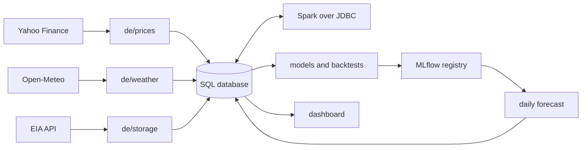

# natural-gas-forecasting

Daily forecasts of the natural gas front-month futures price (Yahoo Finance `NG=F`, daily high), using EIA weekly storage and weather in major gas-demand cities as inputs.

The goal is a small system that runs on its own: pull fresh data each day, keep several models in play, use the most accurate approved one for the published forecast, and track accuracy as actual prices come in.

## Roadmap

- [x] Database and data loaders for prices, weather, and storage
- [x] Spark access to the database over JDBC
- [ ] Data checks for stale, missing, and duplicate data
- [ ] Shared model interface (train, predict, save, load from YAML) with ARIMA, Greykite, and Chronos-2
- [ ] Rolling-origin backtests and a scoreboard (WAPE, MAE, RMSE, bias)
- [ ] MLflow tracking and model stages: Testing, Challenger, Champion, Legacy Champion
- [ ] Daily forecast and weekly retrain jobs in GitHub Actions
- [ ] Streamlit dashboard

## Quickstart

Requires Python 3.10 (Greykite does not support newer versions yet).

```bash
python -m venv .venv
source .venv/bin/activate
pip install -e ".[dev]"

export EIA_API_KEY=your_key   # optional, storage is skipped without it
natgas init-db
natgas ingest all             # 2015-01-01 through today by default
```

Each source can also be loaded on its own:

```bash
natgas ingest prices --start 2024-01-01 --end 2024-06-30
natgas ingest weather
natgas ingest storage
```

Loaders upsert on each table's key, so reruns do not create duplicates. Every run is logged to the `ingestion_runs` table.

## Spark

The SQL database is the system of record and the loaders write to it. `SparkDatabase` in `src/natgas/de/spark_db.py` reads and writes the same tables over JDBC, so later jobs can run on Spark without moving the data.

```bash
pip install -e ".[dev,spark]"
natgas spark-show prices
```

```python
from natgas.config import load_settings
from natgas.de.spark_db import SparkDatabase

database = SparkDatabase(load_settings().db_url)
prices = database.read_table("prices")
database.write_table(prices.select("date", "high"), "prices_high", mode="overwrite")
```

- Needs Java 17, with `JAVA_HOME` set or `java` on the path.
- The JDBC driver (sqlite-jdbc, or the Postgres driver when `NATGAS_DB_URL` is Postgres) is downloaded from Maven Central the first time Spark starts.
- JDBC writes append or overwrite, they do not upsert. Write Spark output to its own tables and leave the loader tables to the loaders.
- Timestamps written from Spark to SQLite keep milliseconds only.
- On Windows, Spark warns at startup that `winutils.exe` and `HADOOP_HOME` are missing. Database reads and writes work without them; they are only needed to write files such as Parquet or CSV.

The Spark tests skip when pyspark or Java is not installed.

Run `make lint` and `make test` before opening a PR.

## Configuration

Settings live in `config/settings.yaml` (ticker, storage series, cities, degree day base). Environment variables:

| Variable | Purpose |
| --- | --- |
| `NATGAS_DB_URL` | SQLAlchemy URL. Defaults to `sqlite:///data/natgas.db`; a Postgres URL works too |
| `EIA_API_KEY` | Needed for storage data |
| `NATGAS_CONFIG` | Path to a different settings file |

## Data sources

| Data | Source | Notes |
| --- | --- | --- |
| Futures prices | [Yahoo Finance](https://finance.yahoo.com/quote/NG=F/) via [yfinance](https://github.com/ranaroussi/yfinance) | Daily OHLCV for `NG=F` |
| Weather | [Open-Meteo](https://open-meteo.com/) archive and forecast APIs | Daily mean temperature, converted to heating and cooling degree days (base 65F) for 8 cities. No key needed |
| Storage | [EIA API v2](https://www.eia.gov/opendata/) | Weekly Lower 48 working gas in storage, series `NW2_EPG0_SWO_R48_BCF`. [Free key](https://www.eia.gov/opendata/register.php) |

## Architecture



Only the ingestion side exists so far; the rest is planned.

## Layout

```
config/settings.yaml    tickers, series, cities
src/natgas/config.py    settings loader
src/natgas/db/          tables, sessions, upsert
src/natgas/de/          data loading
  prices/               PriceLoader (Yahoo Finance)
  weather/              WeatherLoader (Open-Meteo)
  storage/              StorageLoader (EIA)
  utils.py              Loader base class, run logging, HTTP retries, date ranges
  spark_db.py           SparkDatabase, reads and writes the database over JDBC
src/natgas/cli.py       natgas command
tests/                  pytest, no network calls
```
