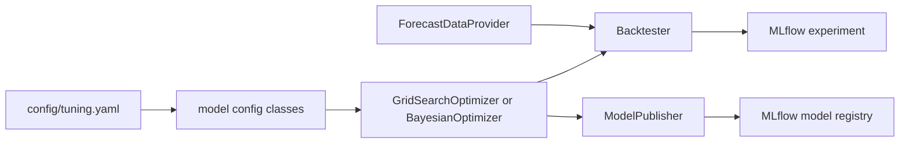
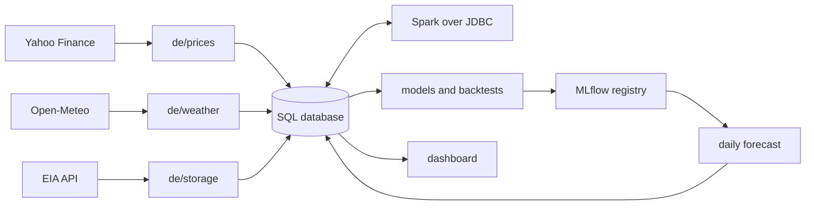

# natural-gas-forecasting

**Start here: [grid search backtest notebook](experiments/grid_search_backtest.ipynb).** It runs every model on the same 127 rolling as-of dates, scores them, and publishes the winner to the MLflow model registry. The [Bayesian search notebook](experiments/bayesian_backtest.ipynb) repeats the search with Optuna.

Daily forecasts of the natural gas front-month futures price (Yahoo Finance `NG=F`, daily high), using weather in major gas-demand cities and EIA weekly storage as inputs.

## Why it matters

Natural gas is one of the most volatile commodities there is. Utilities, power plants, and industrial buyers plan purchases days ahead, and a few cents per MMBtu on millions of MMBtu is real money. Weather drives demand, storage shows how tight supply is, and the futures price reacts to both.

Most forecasting demos stop at one model on one train and test split. This project is built the way a production team would want it: every model is backtested on the same dates with no look-ahead, every run is logged, and a model only replaces the baseline when it earns it.

## What it shows

Prices from 2015-01-02 to 2026-11-18. 127 as-of dates every 14 days from 2021-12-31 to 2026-10-30, each forecasting the next 5 trading days. Same dates for every model. Best config per model, MAE, RMSE, and bias in dollars per MMBtu, MAPE and WAPE in percent.

Grid search (31 configs):

| Model | MAE | RMSE | MAPE | WAPE | Bias | Best config |
| --- | --- | --- | --- | --- | --- | --- |
| Gradient boosting | 0.2462 | 0.3885 | 6.19 | 6.49 | -0.0011 | 5 lags, depth 2, learning rate 0.03, no weather |
| Naive | 0.2462 | 0.3828 | 6.16 | 6.49 | 0.0001 | none |
| Chronos-2 | 0.2482 | 0.3874 | 6.18 | 6.54 | -0.0098 | context 512, no weather |
| Greykite | 0.3035 | 0.4504 | 7.89 | 8.00 | 0.0146 | 4 years of history, 3 price lags, no weather |

Bayesian search (19 configs, 6 trials per model):

| Model | MAE | RMSE | MAPE | WAPE | Bias | Best config |
| --- | --- | --- | --- | --- | --- | --- |
| Naive | 0.2462 | 0.3828 | 6.16 | 6.49 | 0.0001 | none |
| Gradient boosting | 0.2481 | 0.3893 | 6.21 | 6.53 | -0.0049 | 13 lags, depth 2, learning rate 0.018, min leaf 89, weather |
| Chronos-2 | 0.2490 | 0.3903 | 6.23 | 6.56 | -0.0145 | context 1472, no weather |
| Greykite | 0.3198 | 0.4716 | 8.28 | 8.42 | -0.0035 | 4.7 years, 4 price lags, changepoints, ridge |

Nothing beat naive by the 1 percent margin, so the publisher kept naive and registered it as `natgas-price-forecaster` version 3 (`@champion`). That is the expected result for a liquid futures price over a few days, and it is why the publishing rule exists.

What the numbers say:

- Chronos-2 lands within 1 percent of naive in grid search (MAE 0.2482 against 0.2462) with no training at all.
- Weather as a known future covariate did not help Chronos-2 at this horizon. The best Chronos-2 configs in both searches leave it off. Backtests use observed weather as a perfect forecast, so live results with real weather forecasts would not be better.
- Silverkite is built for series with strong trend and seasonality, which day to day futures prices do not have.

## How it works



Every model subclasses `AbstractModelWrapper` (`train`, `predict`, `save`, `load`) and takes a config class that subclasses `AbstractConfigWrapper` (defaults, validation, grid, search space, and what the backtester needs). The backtester, optimizers, and publisher work with any of them.

### Code highlights

`ForecastDataProvider` is the only way a model gets data. It hands out a `ForecastWindow` per as-of date, and `Backtester` refuses to run a window that leaks:

```python
@staticmethod
def check_no_leakage(
    as_of: pd.Timestamp, training_data: pd.DataFrame, forecast_dates: pd.DatetimeIndex
) -> None:
    """Stop the run if any training row is after the as-of date."""
    if training_data.index.max() > as_of:
        raise AssertionError(f"Training data goes past the as-of date {as_of.date()}")
    if forecast_dates.min() <= as_of:
        raise AssertionError(f"Forecast dates must start after {as_of.date()}")
```

`ChronosModel` runs Amazon Chronos-2 zero-shot. The context is prices up to the as-of date, and degree days for the forecast dates go in as known future covariates:

```python
forecast = pipeline.predict_df(
    self.context_frame(),
    future_df=self.future_covariates(future_features, future_calendar),
    prediction_length=len(future_calendar),
    quantile_levels=[0.5],
    id_column=ID_COLUMN,
    timestamp_column=TIME_COLUMN,
    target=TARGET_COLUMN,
    context_length=self.config.context_length,
    freq="B",
)
```

`ModelPublisher` only replaces naive when the winner clears the margin:

```python
improvement = 1 - best.metrics()[metric] / baseline.metrics()[metric]
if best.model_name == BASELINE_MODEL:
    return PublishDecision(baseline, "naive had the lowest error", 0.0)
if improvement >= self.min_improvement:
    reason = f"{best.model_name} beat naive by {improvement:.2%}"
    return PublishDecision(best, reason, improvement)
```

### Models

| Model | What it does |
| --- | --- |
| `NaiveModel` | Repeats the last price. The baseline every other model has to beat. |
| `GradientBoostingModel` | scikit-learn gradient boosted trees on recent daily price changes, plus degree days. Forecasts several days ahead by feeding each prediction back in. |
| `GreykiteModel` | LinkedIn Greykite Silverkite: trend, seasonality, recent prices as lags, and degree days as regressors for the forecast dates. |
| `ChronosModel` | Amazon Chronos-2, a pretrained time series model, used zero-shot on CPU. Heating and cooling degree days can be passed as known future covariates. Tuned on context length and weather on or off. |

### Data, backtests, search, and publishing

| Class | Job |
| --- | --- |
| `ForecastDataProvider` | Give it an as-of date and it returns a `ForecastWindow`: training data on or before that date, feature values for the dates to predict, and the actual prices used to score the forecast. |
| `AbstractFeatureSource` | Base class for extra data. Each source returns only what was known on the as-of date. `WeatherFeatureSource` adds heating and cooling degree days. `StorageFeatureSource` adds the EIA storage level once each weekly report is published. |
| `Backtester` | For each as-of date gets the window, checks for leakage, trains a fresh model, predicts, and records a `BacktestResult`. Runs dates in parallel with `n_jobs`. |
| `BacktestReport`, `ForecastMetrics` | Score one config: MAE, RMSE, MAPE, WAPE, and bias, overall and by days ahead. |
| `AbstractOptimizer` | Backtests candidate configs, logs each one as a nested MLflow run, skips repeats, records failures without stopping, and builds the results table with skill against naive. |
| `GridSearchOptimizer`, `BayesianOptimizer` | Every combination in the grid, or Optuna's TPE sampler picking each next config from the ones already scored. |
| `ModelPublisher` | Publishes the best config only if it lowers error by at least `min_improvement` against naive (1 percent by default). The chosen config is retrained on all data, logged as an MLflow pyfunc model, registered, and given the `champion` alias. |
| `TuningPipeline` | Runs all of the above from `tuning.yaml`. `natgas tune` calls it. |

To add a model, create a folder under `models/` with a config class and a model class, add the pair to `ModelCatalog`, and give it a grid and search space in `tuning.yaml`. Nothing else changes.

### No look-ahead

- Training data always ends on the as-of date, and the test period starts the next trading day. The backtester checks this on every window.
- Storage values only appear once EIA would have published them (6 days after the week ends).
- Weather for future dates would come from the forecast made on the as-of date. Past forecasts are not stored, so backtests use the observed weather as a perfect forecast. This makes weather models look slightly better than they will live. Pass `use_observed_as_forecast=False` to `WeatherFeatureSource` to hide future weather instead.

## Quickstart

Requires Python 3.10 (Greykite does not support newer versions yet). Greykite 1.1 pins pandas below 2.0, numpy 1.26.0, and scikit-learn 1.3.1. Chronos-2's package metadata asks for pandas 2, but the forecast API used here works with pandas 1.5, so it is installed in a second step that leaves pandas alone. Install the CPU build of PyTorch first on a machine without a GPU.

```bash
python -m venv .venv
source .venv/bin/activate
pip install torch --index-url https://download.pytorch.org/whl/cpu
pip install -e ".[dev]"
pip install "chronos-forecasting>=2.0" --no-deps

export EIA_API_KEY=your_key   # optional, storage is skipped without it
natgas init-db
natgas ingest all             # 2015-01-01 through today by default
natgas tune                   # backtest, log to MLflow, register the best model
```

More commands:

```bash
natgas ingest prices --start 2024-01-01 --end 2024-06-30
natgas tune --optimizer bayesian     # Bayesian search instead of grid
natgas tune --no-publish             # backtest and log only
mlflow ui --backend-store-uri sqlite:///mlflow.db
make lint && make test
```

Loaders upsert on each table's key, so reruns do not create duplicates. Every run is logged to the `ingestion_runs` table. Run commands from the repo root: MLflow runs go to `mlflow.db` with artifacts in `mlruns/`, both git ignored. Chronos-2 weights are downloaded from Hugging Face the first time and cached; only the model id is saved with a published model. Load the champion anywhere with:

```python
import mlflow

mlflow.set_tracking_uri("sqlite:///mlflow.db")
model = mlflow.pyfunc.load_model("models:/natgas-price-forecaster@champion")
model.predict(future_dates_frame)  # columns: date, hdd, cdd
```

The two notebooks take about 7 minutes each on an 8 core CPU, most of it Chronos-2.

## Spark

The SQL database is the system of record and the loaders write to it. `SparkDatabase` in `src/natgas/de/spark_db.py` reads and writes the same tables over JDBC, so later jobs can run on Spark without moving the data.

```bash
pip install -e ".[dev,spark]"
natgas spark-show prices
```

```python
from natgas.config import load_settings
from natgas.de.spark_db import SparkDatabase

database = SparkDatabase(load_settings().db_url)
prices = database.read_table("prices")
database.write_table(prices.select("date", "high"), "prices_high", mode="overwrite")
```

- Needs Java 17, with `JAVA_HOME` set or `java` on the path.
- The JDBC driver (sqlite-jdbc, or the Postgres driver when `NATGAS_DB_URL` is Postgres) is downloaded from Maven Central the first time Spark starts.
- JDBC writes append or overwrite, they do not upsert. Write Spark output to its own tables and leave the loader tables to the loaders.
- Timestamps written from Spark to SQLite keep milliseconds only.
- On Windows, Spark warns at startup that `winutils.exe` and `HADOOP_HOME` are missing. Database reads and writes work without them; they are only needed to write files such as Parquet or CSV.

The Spark tests skip when pyspark or Java is not installed.


## Configuration

Settings live in `config/settings.yaml` (ticker, storage series, cities, degree day base). Environment variables:

| Variable | Purpose |
| --- | --- |
| `NATGAS_DB_URL` | SQLAlchemy URL. Defaults to `sqlite:///data/natgas.db`; a Postgres URL works too |
| `EIA_API_KEY` | Needed for storage data |
| `NATGAS_CONFIG` | Path to a different settings file |

## Architecture



Ingestion, backtesting, MLflow tracking, and the model registry exist today. The daily forecast job and dashboard are planned.

## Layout

```
config/settings.yaml    tickers, series, cities
src/natgas/config.py    settings loader
src/natgas/db/          tables, sessions, upsert
src/natgas/de/          data loading
  prices/               PriceLoader (Yahoo Finance)
  weather/              WeatherLoader (Open-Meteo)
  storage/              StorageLoader (EIA)
  utils.py              Loader base class, run logging, HTTP retries, date ranges
  spark_db.py           SparkDatabase, reads and writes the database over JDBC
src/natgas/forecasting/ models, backtests, search, and publishing
  data/                 ForecastDataProvider, ForecastWindow, SqlReader,
                        AbstractFeatureSource, WeatherFeatureSource, StorageFeatureSource
  models/
    base/               AbstractModelWrapper, AbstractConfigWrapper
    naive/              NaiveModel, NaiveModelConfig
    gradient_boosting/  GradientBoostingModel, GradientBoostingModelConfig
    greykite/           GreykiteModel, GreykiteModelConfig
    chronos/            ChronosModel, ChronosModelConfig
    ModelCatalog.py     name to (model class, config class)
  backtesting/          Backtester, BacktestResult, BacktestReport, ForecastMetrics
  optimization/         AbstractOptimizer, GridSearchOptimizer, BayesianOptimizer,
                        HyperparameterGrid, OptimizerCatalog
  tuning/               TuningConfig, TuningPipeline, TuningOutcome, ModelPublisher,
                        PublishDecision, MlflowModelAdapter
config/tuning.yaml      model grids and search spaces, backtest window, publish rule, MLflow
experiments/            grid search and Bayesian search notebooks
src/natgas/cli.py       natgas command
tests/                  pytest, no network calls
```

## Roadmap

- [x] Database and data loaders for prices, weather, and storage
- [x] Spark access to the database over JDBC
- [ ] Data checks for stale, missing, and duplicate data
- [x] Shared model interface (train, predict, save, load) with a config class per model
- [x] Naive, gradient boosting, Greykite, and Chronos-2 models on the same interface
- [ ] ARIMA models
- [x] Rolling-origin backtests and a scoreboard (MAE, RMSE, MAPE, WAPE, bias)
- [x] Grid and Bayesian search logged to MLflow, winner registered as `champion` only if it beats naive
- [ ] Model stages: Testing, Challenger, Champion, Legacy Champion
- [ ] Daily forecast and weekly retrain jobs in GitHub Actions
- [ ] Streamlit dashboard

## Sources

Data:

- Futures prices: [Yahoo Finance `NG=F`](https://finance.yahoo.com/quote/NG=F/) via [yfinance](https://github.com/ranaroussi/yfinance), daily OHLCV
- Weather: [Open-Meteo](https://open-meteo.com/) archive and forecast APIs, daily mean temperature converted to heating and cooling degree days (base 65F) for 8 cities, no key needed
- Storage: [EIA API v2](https://www.eia.gov/opendata/), weekly Lower 48 working gas in storage, series `NW2_EPG0_SWO_R48_BCF`, [free key](https://www.eia.gov/opendata/register.php)

Models and tools:

- [Chronos-2: From Univariate to Universal Forecasting](https://arxiv.org/abs/2510.15821) and the [`amazon/chronos-2`](https://huggingface.co/amazon/chronos-2) model card
- [Greykite](https://github.com/linkedin/greykite) (Silverkite)
- [scikit-learn HistGradientBoostingRegressor](https://scikit-learn.org/stable/modules/generated/sklearn.ensemble.HistGradientBoostingRegressor.html)
- [Optuna](https://optuna.org/) and [MLflow](https://mlflow.org/)
