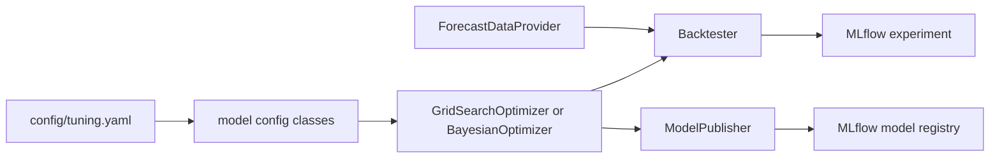
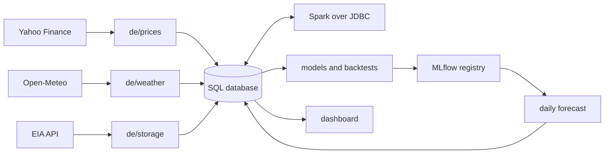

# natural-gas-forecasting

Daily forecasts of the natural gas front-month futures price (Yahoo Finance `NG=F`, daily high), using EIA weekly storage and weather in major gas-demand cities as inputs.

The goal is a small system that runs on its own: pull fresh data each day, keep several models in play, use the most accurate approved one for the published forecast, and track accuracy as actual prices come in.

## Roadmap

- [x] Database and data loaders for prices, weather, and storage
- [x] Spark access to the database over JDBC
- [ ] Data checks for stale, missing, and duplicate data
- [x] Shared model interface (train, predict, save, load) with a config class per model
- [x] Naive, gradient boosting, Greykite, and Chronos models on the same interface
- [ ] ARIMA and Chronos-2 models
- [x] Rolling-origin backtests and a scoreboard (MAE, RMSE, MAPE, WAPE, bias)
- [x] Grid and Bayesian search logged to MLflow, winner registered as `champion` only if it beats naive
- [ ] Model stages: Testing, Challenger, Champion, Legacy Champion
- [ ] Daily forecast and weekly retrain jobs in GitHub Actions
- [ ] Streamlit dashboard

## Quickstart

Requires Python 3.10 (Greykite does not support newer versions yet).

```bash
python -m venv .venv
source .venv/bin/activate
pip install -e ".[dev]"

export EIA_API_KEY=your_key   # optional, storage is skipped without it
natgas init-db
natgas ingest all             # 2015-01-01 through today by default
natgas tune                   # backtest, log to MLflow, register the best model
```

Each source can also be loaded on its own:

```bash
natgas ingest prices --start 2024-01-01 --end 2024-06-30
natgas ingest weather
natgas ingest storage
```

Loaders upsert on each table's key, so reruns do not create duplicates. Every run is logged to the `ingestion_runs` table.

## Spark

The SQL database is the system of record and the loaders write to it. `SparkDatabase` in `src/natgas/de/spark_db.py` reads and writes the same tables over JDBC, so later jobs can run on Spark without moving the data.

```bash
pip install -e ".[dev,spark]"
natgas spark-show prices
```

```python
from natgas.config import load_settings
from natgas.de.spark_db import SparkDatabase

database = SparkDatabase(load_settings().db_url)
prices = database.read_table("prices")
database.write_table(prices.select("date", "high"), "prices_high", mode="overwrite")
```

- Needs Java 17, with `JAVA_HOME` set or `java` on the path.
- The JDBC driver (sqlite-jdbc, or the Postgres driver when `NATGAS_DB_URL` is Postgres) is downloaded from Maven Central the first time Spark starts.
- JDBC writes append or overwrite, they do not upsert. Write Spark output to its own tables and leave the loader tables to the loaders.
- Timestamps written from Spark to SQLite keep milliseconds only.
- On Windows, Spark warns at startup that `winutils.exe` and `HADOOP_HOME` are missing. Database reads and writes work without them; they are only needed to write files such as Parquet or CSV.

The Spark tests skip when pyspark or Java is not installed.

Run `make lint` and `make test` before opening a PR.

## Forecasting framework

The forecasting code lives in `src/natgas/forecasting/`. Every model is configured, trained, backtested, and published the same way, which makes models easy to compare and hard to cheat.

Experiments: [grid search](experiments/grid_search_backtest.ipynb) and [Bayesian search](experiments/bayesian_backtest.ipynb) notebooks run every model on the same dates and metrics.



### Models

| Model | What it does |
| --- | --- |
| `NaiveModel` | Repeats the last price. The baseline every other model has to beat. |
| `GradientBoostingModel` | scikit-learn gradient boosted trees on recent daily price changes, plus degree days. Forecasts several days ahead by feeding each prediction back in. |
| `GreykiteModel` | LinkedIn Greykite Silverkite: trend, seasonality, recent prices as lags, and degree days as regressors for the forecast dates. |
| `ChronosModel` | Amazon Chronos, a pretrained time series model, used zero-shot on CPU. Choose the model size, context length, and median, mean, or quantile output. |

Each model has a matching config class (`NaiveModelConfig`, `GradientBoostingModelConfig`, `GreykiteModelConfig`, `ChronosModelConfig`). All of them follow `AbstractConfigWrapper`, which defines:

- defaults and validation for every hyperparameter
- the default grid for grid search and the default search space for Bayesian search
- `to_dict` and `from_dict` for YAML and MLflow params
- what the backtester needs: required feature columns, the longest horizon, and the least history the model can train on

Every model subclasses `AbstractModelWrapper` and takes its config in the constructor: `train`, `predict`, `save`, `load`. `ModelCatalog` maps a name in `tuning.yaml` to its (model class, config class) pair.

### Data and backtests

| Class | Job |
| --- | --- |
| `ForecastDataProvider` | The only way models get data. Give it an as-of date and it returns a `ForecastWindow`: training data on or before that date, feature values for the dates to predict, and the actual prices used to score the forecast. |
| `AbstractFeatureSource` | Base class for extra data. Each source returns only what was known on the as-of date. `WeatherFeatureSource` adds heating and cooling degree days. `StorageFeatureSource` adds the EIA storage level once each weekly report is published. |
| `Backtester` | Checks the config against the provider, then for each as-of date gets the window, checks for leakage, trains a fresh model, predicts, and records a `BacktestResult`. Runs dates in parallel with `n_jobs`. |
| `BacktestReport`, `ForecastMetrics` | Collect the results for one config and score them: MAE, RMSE, MAPE, WAPE, and bias, overall and by days ahead. |

### Search (`optimization/`) and publishing (`tuning/`)

| Class | Job |
| --- | --- |
| `AbstractOptimizer` | Backtests candidate configs, logs each one as a nested MLflow run, skips repeats, records failures without stopping, and builds the results table with skill against naive. |
| `GridSearchOptimizer` | Tries every combination in each model's grid. |
| `BayesianOptimizer` | Uses Optuna's TPE sampler to pick each next config from the ones already scored. |
| `OptimizerCatalog` | Builds the optimizer named in `tuning.yaml` (`search.optimizer: grid` or `bayesian`). |
| `ModelPublisher` | Publishes the best config only if it lowers error by at least `min_improvement` against naive (1 percent by default). Otherwise it publishes naive. The chosen config is retrained on all data, logged as an MLflow pyfunc model, registered, and given the `champion` alias. |
| `TuningPipeline` | Runs all of the above from `tuning.yaml`. `natgas tune` calls it. |

### No look-ahead

- Training data always ends on the as-of date, and the test period starts the next trading day. The backtester checks this on every window and stops if it is broken.
- Storage values only appear once EIA would have published them (6 days after the week ends).
- Weather for future dates would come from the forecast made on the as-of date. Past forecasts are not stored, so backtests use the observed weather as a perfect forecast. This makes weather models look slightly better than they will live. Pass `use_observed_as_forecast=False` to `WeatherFeatureSource` to hide future weather instead.

### Run it

```bash
natgas ingest all
natgas tune                          # grid search from config/tuning.yaml
natgas tune --optimizer bayesian     # Bayesian search instead
natgas tune --no-publish             # backtest and log only
mlflow ui --backend-store-uri sqlite:///mlflow.db
```

Run these from the repo root. MLflow runs are stored in `mlflow.db` with artifacts in `mlruns/`; both are git ignored. Load the published model anywhere with:

```python
import mlflow

mlflow.set_tracking_uri("sqlite:///mlflow.db")
model = mlflow.pyfunc.load_model("models:/natgas-price-forecaster@champion")
model.predict(future_dates_frame)  # columns: date, hdd, cdd
```

Chronos weights are downloaded from Hugging Face the first time and cached. Only the model id is saved with a published Chronos model.

### Installing

Greykite 1.1 pins pandas below 2.0, numpy 1.26.0, and scikit-learn 1.3.1, so the project uses those versions. On a machine without a GPU, install the CPU build of PyTorch first to save a large download:

```bash
pip install torch --index-url https://download.pytorch.org/whl/cpu
pip install -e ".[dev]"
```

### Adding a model

Create a folder under `models/` with a config class (subclass `AbstractConfigWrapper`) and a model class (subclass `AbstractModelWrapper`), add the pair to `ModelCatalog`, and give it a grid and search space in `tuning.yaml`. The backtester, optimizers, and publisher need no changes.

### Results

Prices from 2015 through 2026-11-18. 127 as-of dates every 14 days from 2021-12-31 to 2026-10-30, each forecasting the next 5 trading days. Best config per model, MAE in dollars per MMBtu:

| Model | Grid search MAE | Grid RMSE | Grid WAPE | Bayesian MAE | Best grid config |
| --- | --- | --- | --- | --- | --- |
| Gradient boosting | 0.2462 | 0.3885 | 6.49% | 0.2481 | 5 lags, depth 2, learning rate 0.03, no weather |
| Naive | 0.2462 | 0.3828 | 6.49% | 0.2462 | none |
| Chronos | 0.2525 | 0.3927 | 6.65% | 0.2556 | chronos-bolt-base, context 128, median |
| Greykite | 0.3035 | 0.4504 | 8.00% | 0.3198 | 4 years of history, 3 price lags, no weather |

Grid search tried 31 configs and Bayesian search 18, on the same dates. Nothing beat naive by the 1 percent margin, so the publisher kept naive and registered it as `natgas-price-forecaster` version 1 (`@champion`). This is the expected result for a liquid futures price over a few days, and it is why the publishing rule exists: a fancier model has to earn its place. Chronos comes close zero-shot with no training at all. Silverkite is built for series with strong trend and seasonality, which day to day futures prices do not have.
## Configuration

Settings live in `config/settings.yaml` (ticker, storage series, cities, degree day base). Environment variables:

| Variable | Purpose |
| --- | --- |
| `NATGAS_DB_URL` | SQLAlchemy URL. Defaults to `sqlite:///data/natgas.db`; a Postgres URL works too |
| `EIA_API_KEY` | Needed for storage data |
| `NATGAS_CONFIG` | Path to a different settings file |

## Data sources

| Data | Source | Notes |
| --- | --- | --- |
| Futures prices | [Yahoo Finance](https://finance.yahoo.com/quote/NG=F/) via [yfinance](https://github.com/ranaroussi/yfinance) | Daily OHLCV for `NG=F` |
| Weather | [Open-Meteo](https://open-meteo.com/) archive and forecast APIs | Daily mean temperature, converted to heating and cooling degree days (base 65F) for 8 cities. No key needed |
| Storage | [EIA API v2](https://www.eia.gov/opendata/) | Weekly Lower 48 working gas in storage, series `NW2_EPG0_SWO_R48_BCF`. [Free key](https://www.eia.gov/opendata/register.php) |

## Architecture



Ingestion, backtesting, MLflow tracking, and the model registry exist today. The daily forecast job and dashboard are planned.

## Layout

```
config/settings.yaml    tickers, series, cities
src/natgas/config.py    settings loader
src/natgas/db/          tables, sessions, upsert
src/natgas/de/          data loading
  prices/               PriceLoader (Yahoo Finance)
  weather/              WeatherLoader (Open-Meteo)
  storage/              StorageLoader (EIA)
  utils.py              Loader base class, run logging, HTTP retries, date ranges
  spark_db.py           SparkDatabase, reads and writes the database over JDBC
src/natgas/forecasting/ models, backtests, search, and publishing
  data/                 ForecastDataProvider, ForecastWindow, SqlReader,
                        AbstractFeatureSource, WeatherFeatureSource, StorageFeatureSource
  models/
    base/               AbstractModelWrapper, AbstractConfigWrapper
    naive/              NaiveModel, NaiveModelConfig
    gradient_boosting/  GradientBoostingModel, GradientBoostingModelConfig
    greykite/           GreykiteModel, GreykiteModelConfig
    chronos/            ChronosModel, ChronosModelConfig
    ModelCatalog.py     name to (model class, config class)
  backtesting/          Backtester, BacktestResult, BacktestReport, ForecastMetrics
  optimization/         AbstractOptimizer, GridSearchOptimizer, BayesianOptimizer,
                        HyperparameterGrid, OptimizerCatalog
  tuning/               TuningConfig, TuningPipeline, TuningOutcome, ModelPublisher,
                        PublishDecision, MlflowModelAdapter
config/tuning.yaml      model grids and search spaces, backtest window, publish rule, MLflow
experiments/            grid search and Bayesian search notebooks
src/natgas/cli.py       natgas command
tests/                  pytest, no network calls
```
